  
  

가천대학교 컴퓨터공학과에 다니고 있고, 2026년 2월부터 iNES Lab AI팀 학부연구생으로 인공 시각을 연구하고 있습니다. 학·석사 연계과정으로 석사까지 이어서 연구할 계획입니다.

 

인공 망막을 쓰는 사람은 세상을 수백 개 정도의 빛 점(phosphene)으로 봅니다. 이렇게 적은 점으로 길을 걸으려면 장면에서 무엇을 남겨야 하는지를 연구하고 있습니다.

  
  
  

처음에는 가장 중요한 물체 하나만 진하게 보여주면 된다고 생각했습니다. 그런데 물체만 덩그러니 떠 있으면 그게 어디에 있는 무엇인지 알아보기 어려웠고, 그래서 지금은 물체와 주변 윤곽을 정해진 점 개수 안에서 어떻게 나눠 담을지를 보고 있습니다. 실내 장면은 ProcTHOR 시뮬레이션으로, 실외 보행 장면은 SANPO 데이터셋으로 실험합니다.

 

  <a href="https://github.com/Team-DALM"></a>
  <a href="https://github.com/HoGenny/gachon-graderoad"></a>
  <a href="https://github.com/HoGenny/university-nlp-final-project"></a>
  <a href="https://github.com/HoGenny/university-cloudnative-final-project"></a>
  <a href="https://github.com/HoGenny/polioo"></a>
  <a href="https://github.com/HoGenny/javafinal-galaxy-defender"></a>

 

  
  
  
  
  
  
  

  
  
  
  
  
  
  

  
  
  
  
  

 

- 제6회 대한민국 신직업·미래직업 아이디어 공모전 (2025): 3인 팀으로 '건물 에너지 효율화 컨설턴트'라는 직업을 제안
- [자료구조 코드 모음](https://github.com/HoGenny/university-data-structures): 2025년 1학기 자료구조 수업 코드를 주차별로 정리

