<picture>
  <source media="(prefers-color-scheme: dark)" srcset="assets/header-dark.svg" />
  
</picture>

  <a href="https://singular-clafoutis-fd1e7b.netlify.app/"><picture><source media="(prefers-color-scheme: dark)" srcset="assets/btn-portfolio-dark.svg" /></picture></a>
  <a href="mailto:tyui3024@icloud.com"><picture><source media="(prefers-color-scheme: dark)" srcset="assets/btn-email-dark.svg" /></picture></a>

가천대학교 컴퓨터공학과에 다니고 있고, 2026년 2월부터 iNES Lab AI팀 학부연구생으로 인공 시각을 연구하고 있습니다. 학·석사 연계과정으로 석사까지 이어서 연구할 계획입니다.

### Research

인공 망막을 쓰는 사람은 세상을 수백 개 정도의 빛 점(phosphene)으로 봅니다. 이렇게 적은 점으로 길을 걸으려면 장면에서 무엇을 남겨야 하는지를 연구하고 있습니다.

처음에는 가장 중요한 물체 하나만 진하게 보여주면 된다고 생각했습니다. 그런데 물체만 덩그러니 떠 있으면 그게 어디에 있는 무엇인지 알아보기 어려웠고, 그래서 지금은 물체와 주변 윤곽을 정해진 점 개수 안에서 어떻게 나눠 담을지를 보고 있습니다.

  <picture><source media="(prefers-color-scheme: dark)" srcset="assets/step-1-dark.svg" />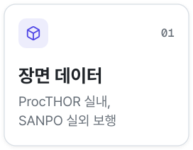</picture>
  <picture><source media="(prefers-color-scheme: dark)" srcset="assets/step-2-dark.svg" />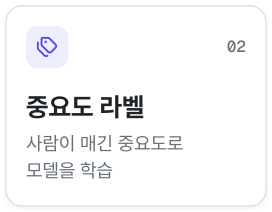</picture>
  <picture><source media="(prefers-color-scheme: dark)" srcset="assets/step-3-dark.svg" />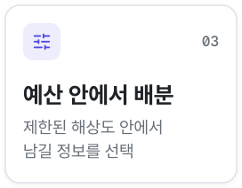</picture>
  <picture><source media="(prefers-color-scheme: dark)" srcset="assets/step-4-dark.svg" />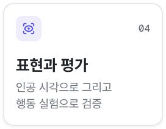</picture>

### Projects

  <a href="https://github.com/Team-DALM"><picture><source media="(prefers-color-scheme: dark)" srcset="assets/card-dalm-dark.svg" />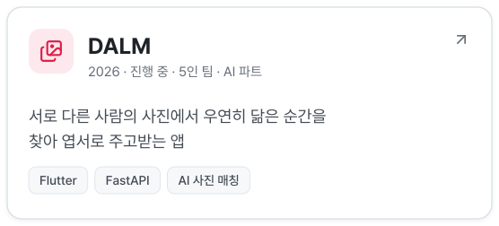</picture></a>
  <a href="https://github.com/HoGenny/gachon-graderoad"><picture><source media="(prefers-color-scheme: dark)" srcset="assets/card-gradroad-dark.svg" />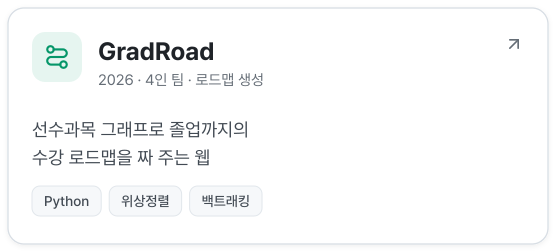</picture></a>
  <a href="https://github.com/HoGenny/university-nlp-final-project"><picture><source media="(prefers-color-scheme: dark)" srcset="assets/card-korean-qa-dark.svg" />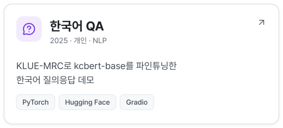</picture></a>
  <a href="https://github.com/HoGenny/university-cloudnative-final-project"><picture><source media="(prefers-color-scheme: dark)" srcset="assets/card-guestbook-dark.svg" />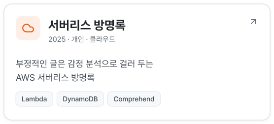</picture></a>
  <a href="https://github.com/HoGenny/polioo"><picture><source media="(prefers-color-scheme: dark)" srcset="assets/card-polioo-dark.svg" />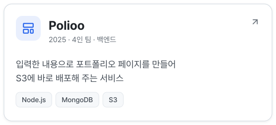</picture></a>
  <a href="https://github.com/HoGenny/javafinal-galaxy-defender"><picture><source media="(prefers-color-scheme: dark)" srcset="assets/card-galaxy-defender-dark.svg" />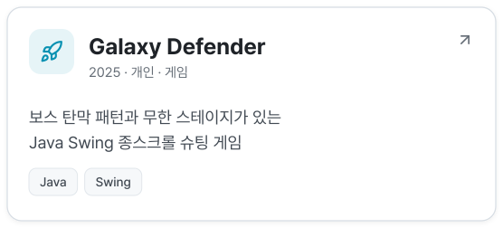</picture></a>

### Stack

  <picture><source media="(prefers-color-scheme: dark)" srcset="assets/chip-python-dark.svg" /></picture>
  <picture><source media="(prefers-color-scheme: dark)" srcset="assets/chip-pytorch-dark.svg" /></picture>
  <picture><source media="(prefers-color-scheme: dark)" srcset="assets/chip-opencv-dark.svg" /></picture>
  <picture><source media="(prefers-color-scheme: dark)" srcset="assets/chip-hugging-face-dark.svg" /></picture>
  <picture><source media="(prefers-color-scheme: dark)" srcset="assets/chip-jupyter-dark.svg" /></picture>
  <picture><source media="(prefers-color-scheme: dark)" srcset="assets/chip-gradio-dark.svg" /></picture>
  <picture><source media="(prefers-color-scheme: dark)" srcset="assets/chip-nodejs-dark.svg" /></picture>
  <picture><source media="(prefers-color-scheme: dark)" srcset="assets/chip-express-dark.svg" /></picture>
  <picture><source media="(prefers-color-scheme: dark)" srcset="assets/chip-mongodb-dark.svg" /></picture>
  <picture><source media="(prefers-color-scheme: dark)" srcset="assets/chip-aws-dark.svg" /></picture>
  <picture><source media="(prefers-color-scheme: dark)" srcset="assets/chip-docker-dark.svg" /></picture>
  <picture><source media="(prefers-color-scheme: dark)" srcset="assets/chip-linux-dark.svg" /></picture>
  <picture><source media="(prefers-color-scheme: dark)" srcset="assets/chip-react-dark.svg" /></picture>
  <picture><source media="(prefers-color-scheme: dark)" srcset="assets/chip-typescript-dark.svg" /></picture>
  <picture><source media="(prefers-color-scheme: dark)" srcset="assets/chip-java-dark.svg" /></picture>
  <picture><source media="(prefers-color-scheme: dark)" srcset="assets/chip-git-dark.svg" /></picture>

### More

- 제6회 대한민국 신직업·미래직업 아이디어 공모전 (2025): 3인 팀으로 '건물 에너지 효율화 컨설턴트'라는 직업을 제안
- [자료구조 코드 모음](https://github.com/HoGenny/university-data-structures): 2025년 1학기 자료구조 수업 코드를 주차별로 정리
